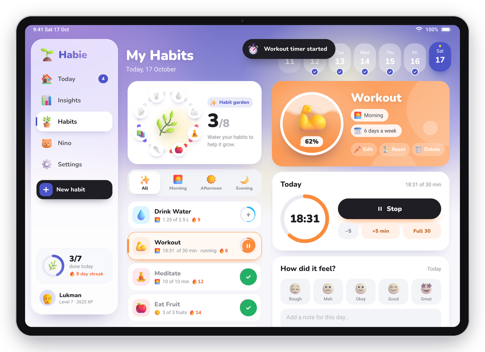
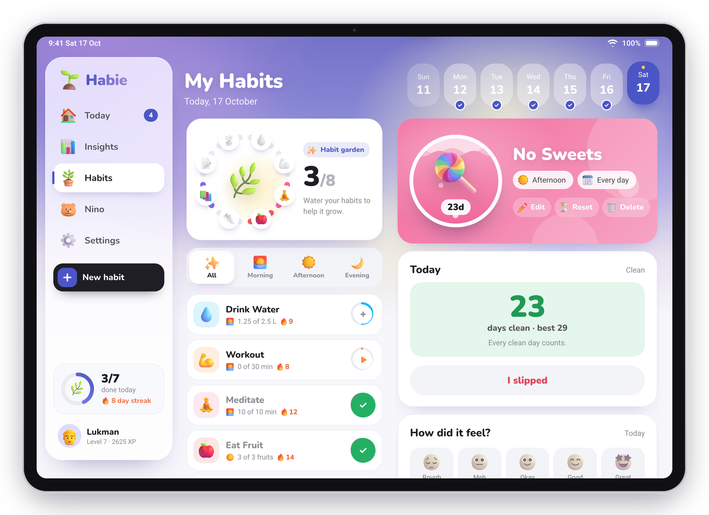
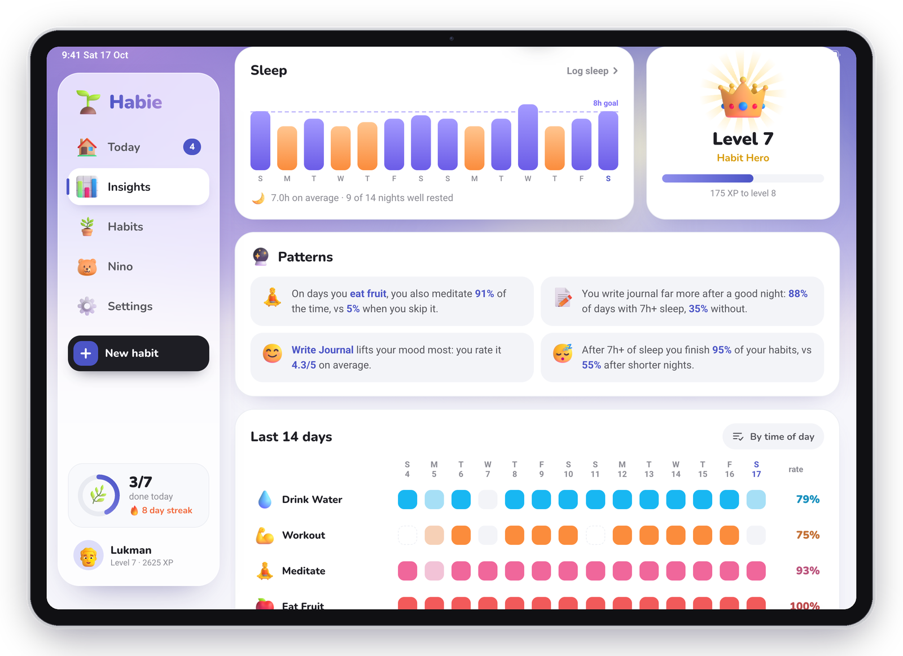
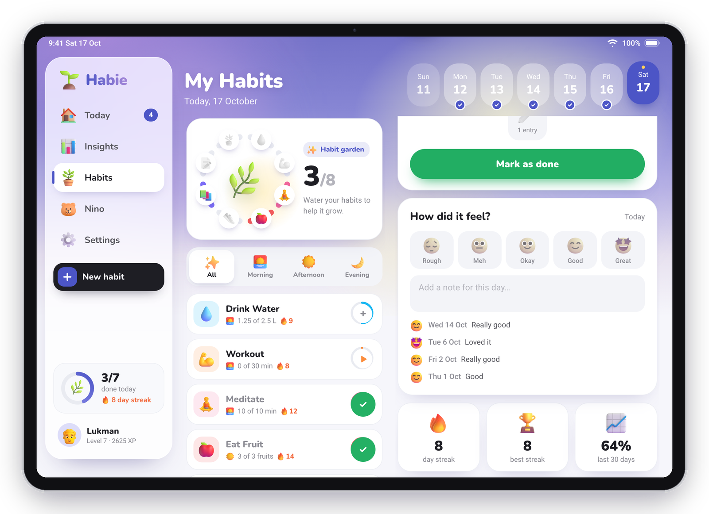

<div align="center">


# Habie

**A habit tracker you grow like a garden. Built for the iPad, installed from the browser, no app store in between.**

Every habit is a plant. Log a glass of water, a timed workout or a day without sweets and its ring fills, the garden
in the middle blooms, and a little 3D buddy cheers you on. Ask that buddy to set things up and it does: it's an AI
that can create, log and change anything in the app.

**[Open Habie →](https://abhinav-prabhakar.github.io/Habie/)**

-1180%20×%20820%20pt-7372c8?style=flat-square)


[Screens](#screens) · [Features](#features) · [AI buddy](#the-ai-buddy) · [Quickstart](#quickstart) · [Install on iPad](#install-it-on-an-ipad) · [Deploying](#deploying-with-your-own-key)

</div>

---

## Why this exists

Most habit trackers are spreadsheets with checkboxes. They work for a week, then the streak breaks and the app goes in a
folder. Habie bets on the opposite: make the tracking itself the reward, and forgive the bad days.

- **Visual first.** Water is a tank that fills, a day is a ring of plants, a streak is a flame with a bear in it.
  Numbers are there, but they're never the first thing you see.
- **Forgiving by design.** Rest days pause everything without breaking your streak, and every week of streak earns a
  freeze that saves it on a day you miss. People quit when streaks break; Habie tries hard not to break them.
- **One device, done properly.** It's designed for exactly one screen: the iPad (A16, 11th generation) in landscape,
  1180 × 820 points. A sidebar, split views and form sheets, the way an iPad app should feel.
- **Nothing to install from a store.** It's a Progressive Web App. Open the link in Safari, add it to the Home Screen,
  and it launches full screen with its own icon, splash screen and offline support.

## Screens

The screenshots use the built-in demo garden (`?demo`). A new install starts empty.

| | |
|---|---|
|  |  |
| **Today.** A greeting that knows the time of day, three stat cards (water, last night's sleep, minutes moved), habits grouped into morning, afternoon and evening, and a progress ring. Timers get a play button, quit habits count their clean days, and a rest day is one tap away. | **Habits.** The list on the left, the habit on the right, like Mail or Notes. The garden ring has one petal per habit and the plant in the middle grows from seedling to sunflower. Water is poured in litres: +100, +250 or +500 ml. |
|  |  |
| **Timers.** Start a timer when you begin a workout or meditation. It keeps running if you leave the app, cheers when you hit the goal, and logs the minutes when you stop. | **Quit habits.** For things you're breaking. Habie counts the days since your last slip and your best run, and logging a slip is gentle: it resets the counter, not your progress. |
|  |  |
| **Insights.** The streak with this week's track (frozen and rest days marked), your freezes, the week's score, fourteen nights of sleep, your level, a 14-day grid of every habit and a month calendar. | **Patterns.** Plain statistics over your last eight weeks: how sleep changes your days, which habits go together, your strongest weekdays and time of day, what lifts your mood. Ask your buddy and it explains the likely causes and what to try. |
|  |  |
| **Notes and mood.** Every check-in can carry a mood from rough to great and a short note. Recent notes sit under it, and moods feed the Patterns card. | **Buddy.** An AI that acts instead of describing: one message can create habits, log what you did and change the theme. Replies render Markdown and LaTeX. Seven 3D buddies to choose from. *(Demo conversation.)* |
|  |  |
| **New habit.** Pick a type (check-in, litres, timer or quit), one of 140 icons in seven tabs, a colour, the time of day, and how it repeats: on chosen weekdays, every few days, or a number of times a week. | **Settings.** Your level and XP ring, 22 badges that unlock from what you actually log, dark mode, four colour themes, seven buddies, reminders, sounds, focus mode, the buddy's brain and your data. |
|  |  |
| **A perfect day.** Finish everything due and your buddy jumps for joy under a burst of confetti. Level-ups, badges and freezes queue up behind it, so no celebration hides another. | **Dark mode, Peach theme.** Every colour comes from a token, so dark mode and the four themes reach every corner, including the status bar tint. |

<div align="center">


<br />
<b>Pouring water, and planting a timed habit.</b> Both recordings are the real app at the iPad's resolution, not mock-ups.
<br /><br />

<br />
<b>Dark mode, four themes and seven buddies.</b> Theme changes spread out from your finger with the View Transitions API.
</div>

## Features

**Habits that fit real life**

- **Four types.** *Check-in* (tick it, or count up to a goal: pages in fives, fruit one at a time), *Litres* (a water
  tank with +100 / +250 / +500 ml), *Timer* (start, stop, minutes logged) and *Quit* (days since your last slip).
- **Three schedules.** On chosen weekdays, every N days, or N times a week on whichever days suit you. Weekly habits
  show "2 of 3 this week" and keep a streak in weeks.
- **Notes and mood** on every check-in, with the latest ones shown on the habit.
- **Fix yesterday.** The week strip on *Habits* opens any past day of this week; logs, notes and the garden follow.

**Streaks that survive bad days**

- **Rest days.** Not feeling it? Mark today as a rest day: nothing is due, and the streak neither grows nor breaks.
- **Streak freezes.** Every 7-day streak earns a freeze, up to 3 in the bank. When a day ends unfinished, a freeze is
  spent automatically and the streak lives on; the day shows an ice cube in the week track.
- **Fair counting.** Days with nothing scheduled are skipped, quit habits never block a perfect day, and weekly habits
  are judged by the week.

**Rewards**

- **Celebrations that mean something.** Confetti from the button you pressed, a *Perfect day* card, level-ups every
  400 XP, and a toast for each of the 22 badges: streak tiers, night owl, sweet dreams, weekend hero and more.
- **140 icons** of 3D Fluent Emoji in seven tabs (Health, Food, Move, Mind, Home, Work, Create).

**Insights**

- **Patterns** found with plain statistics, written in plain English, and an AI write-up on request, kept until you ask again.
- **Charts** for the week, sleep, the last 14 days of every habit and the month.

**Everyday polish**

- **Reminders** per habit, with a notification while Habie is open and a bell that shows what's overdue.
- **Search** that also plants a habit from whatever you typed.
- **Offline from the first launch.** The service worker precaches every file, fonts and the Markdown/LaTeX libraries
  included.
- **Synthesised sounds.** Little chimes come from Web Audio; the app ships no audio files.
- **Touch first.** No keyboard shortcuts to learn; every action is a tap.

## The AI buddy

The buddy is an OpenAI-compatible chat model with tools for everything in the app. It reads your garden (habits,
today's progress, streaks, notes, settings) with every message and acts on it.

| It can | For example |
|---|---|
| create, edit and delete habits of any type and schedule | "Add a 10 minute meditation on weekdays at 7, with a reminder" |
| log progress, slips and sleep for any day | "I drank two glasses of water and read 15 pages" |
| run timers and save moods and notes | "Start my workout timer" · "Yoga felt great today" |
| set rest days and read patterns | "I'm sick, make today a rest day" · "What affects my habits most?" |
| change settings, theme, name and buddy, and open screens | "Dark mode with the mint theme, and call me Abhi" |

It replies in Markdown with LaTeX (rendered by [marked](https://github.com/markedjs/marked),
[DOMPurify](https://github.com/cure53/DOMPurify) and [KaTeX](https://katex.org), all bundled for offline use) and adds
buttons that jump to whatever it changed. It deletes a habit or wipes data only after you've confirmed.

**Model.** [`config.js`](config.js) points at [VoidAI](https://voidai.app)'s free plan and uses `gpt-4.1-mini`, falling
back to `gpt-4o-mini` if a call fails. Both handle tool calls well and are among the cheapest models on that plan.
Any OpenAI-compatible endpoint works: change `apiBase` and `models`.

**The key.** It's never in the repository.

- On the live site, the GitHub Pages workflow writes it into `config.js` at deploy time from the `VOIDAI_API_KEY`
  repository secret (see [Deploying](#deploying-with-your-own-key)).
- On any device, **Settings → Buddy brain** takes your own key. It's stored in that browser only, never in the export,
  and it's used instead of the deployed one.
- No key, no network, or out of quota: the buddy falls back to a small offline responder that still answers about
  your schedule, progress, water and sleep.

> [!IMPORTANT]
> A key used by a static site is sent to every visitor's browser, so a determined person can read it. Use a free or
> capped key. To keep a key fully private, put a small proxy in front of the API and set `chatEndpoint` instead.

**Your own backend.** Set `chatEndpoint` in `config.js` and each message is sent as
`POST { message, image, history: [{ role, content }], context }`; reply with
`{ "reply": "Markdown text", "actions": [{ "label": "Log water", "href": "#habits/water" }] }`.

## How it fits together

```
  ┌──────────────────────────────────────────────────────────────┐
  │  index.html · styles.css   one 1180 × 820 artboard: sidebar, │  static files, no framework,
  │                            five sections, sheets, popovers   │  no build step
  └──────────────────────────────▲───────────────────────────────┘
  ┌──────────────────────────────┴───────────────────────────────┐
  │  js/app.js   renders every section from state, routes by     │  hash routes: #home #insights
  │              #hash, timers, slips, rest days, transitions    │  #habits/<id> #buddy #settings #new
  └──────▲───────────────▲──────────────────▲──────────────▲─────┘
  ┌──────┴──────┐ ┌──────┴───────┐ ┌────────┴───────┐ ┌────┴─────────┐
  │ js/store.js │ │  js/fx.js    │ │  js/chat.js    │ │  js/pwa.js   │
  │ state, log, │ │ confetti,    │ │ the AI buddy:  │ │ service      │
  │ schedules,  │ │ toasts,      │ │ tools, Markdown│ │ worker,      │
  │ streaks,    │ │ sounds,      │ │ + LaTeX, the   │ │ install      │
  │ freezes,    │ │ count-ups    │ │ Patterns write-│ │ prompt and   │
  │ patterns    │ │              │ │ up, offline    │ │ instructions │
  └──────▲──────┘ └──────────────┘ └────────────────┘ └────▲─────────┘
  ┌──────┴──────────────┐                              ┌───┴──────────┐
  │ localStorage        │                              │ sw.js        │
  │ habie.v3            │                              │ precaches    │
  │ everything you log  │                              │ the app      │
  └─────────────────────┘                              └──────────────┘
```

**Design principles**

- **Designed for one screen.** The artboard is the iPad's landscape viewport, 1180 × 820 points at 2×. The width
  is fixed; the height follows the window, so it fits both Safari (with its toolbars) and the full-screen PWA. Hold
  the iPad upright and Habie asks you to turn it; Split View and Stage Manager windows are left alone.
- **Visuals before text.** A habit is an icon, a colour and a ring. Progress is a fill, never just a number.
- **Motion that explains.** Sections slide in the direction you travelled, cards arrive one after another, rings and
  bars grow to their value, and celebrations queue instead of stacking. Everything honours *Reduce Motion*.
- **Everything is derived from the log.** What's stored is what you did on which day, plus notes, rest days and
  freezes. Streaks, XP, badges, patterns, the garden and every chart are computed from that, so they never disagree.
- **Your data stays on the iPad.** No account. Export it as JSON or start fresh from Settings. Only buddy messages
  (with a summary of your garden) go to the chat API.

## Quickstart

Any static file server works. From the repository root:

```bash
python3 -m http.server 8000
```

Open http://localhost:8000. You start with an empty garden. To explore with six weeks of history, open
http://localhost:8000/?reset&demo instead. To try the AI buddy locally, paste a key in **Settings → Buddy brain**.

**Things to try** (in the demo garden)

1. On **Today**, press play on *Workout*, then stop it to log the minutes.
2. Open **Habits → No Sweets** and see the clean-day counter; log a slip, then undo it.
3. Open **Insights** and scroll to **Patterns**: sleep, weekdays and moods, found in the demo history.
4. Tap **New habit**, choose *Timer*, *Times a week*, and plant it.
5. Ask the buddy: "Make today a rest day and switch to the rose theme."

## Install it on an iPad

A PWA needs HTTPS to install (localhost is the only exception).

1. Open **[abhinav-prabhakar.github.io/Habie](https://abhinav-prabhakar.github.io/Habie/)** in **Safari** on the iPad.
2. Tap **Share**, then **Add to Home Screen**.
3. Launch **Habie** from the Home Screen. It opens full screen, landscape, with its own splash screen.

Habie offers this itself: after a few seconds a banner slides in, and **Install Habie** sits in the sidebar until it's
installed. Updates arrive on their own the next time it opens.

## Deploying with your own key

The site deploys to GitHub Pages with [`.github/workflows/pages.yml`](.github/workflows/pages.yml) on every push to
`main`. For a fork:

1. **Settings → Pages → Source: GitHub Actions.**
2. **Settings → Secrets and variables → Actions → New repository secret** named `VOIDAI_API_KEY` (or any
   OpenAI-compatible key, with `apiBase` changed in `config.js`).
3. Push. The workflow copies the site, writes the key into the deployed `config.js` only, and publishes it.

Without the secret the site still deploys; the buddy uses its offline answers until someone adds a key in Settings.

## Layout

```
index.html  styles.css      the artboard: 1180 × 820, scaled to the window; metadata and link previews
config.js                   chat API base, models, optional custom endpoint (no keys)
js/app.js                   sections, routing, timers, slips, rest days, editor, transitions
js/store.js                 state, schedules, streaks, freezes, notes, patterns, badges, the demo seed
js/chat.js                  the AI buddy: tools, Markdown + LaTeX, Patterns write-up, offline replies
js/fx.js                    confetti, toasts, sounds, count-ups
js/pwa.js  sw.js            install flow, offline cache
manifest.webmanifest        name, icons, shortcuts, screenshots
assets/3d/                  Fluent Emoji 3D artwork (MIT)
assets/vendor/              marked, DOMPurify, KaTeX (MIT / Apache-2.0)
assets/fonts/               Nunito and Roboto, self-hosted
assets/icons/  splash/      app icons, favicons, iPad launch screens; assets/og.png is the link preview
.github/workflows/          the Pages deploy that injects the API key
tools/                      asset, precache and mock-up scripts
docs/images/                the pictures in this README
```

**Dev hooks**, as query strings: `?demo` the seeded demo garden (with `?reset` to start it over) · `?reset` clear
saved data · `?mockup` draw the iPadOS status bar and hide the install prompts · `?nosplash` skip the launch animation.

**Regenerating things**

| | |
|---|---|
| `python3 tools/precache.py` | refresh the offline file list and cache version in `sw.js` after changing files |
| `node tools/mockups.js <dir>` then `python3 tools/frame.py <dir>` | recapture the README screenshots and GIFs (Playwright, ffmpeg, the app served on :8765; `PW_CHANNEL=chrome` uses installed Chrome) |
| `node tools/build-assets.js` | redraw the app icons, iPad launch screens and the link-preview image |

## What this is not, yet

- **Reminders only fire while Habie is open.** Background notifications on iPadOS need Web Push, which needs a server.
- **One iPad, one garden.** Data lives in this browser's storage. There's no sync between devices; export is a JSON file.
- **The deployed key is visible to visitors.** It's fine for a free key; a private key needs a proxy.
- **Landscape only.** An upright iPad shows a "turn your iPad" screen; other screen sizes are scaled, not redesigned.

## Credits

Artwork is [Microsoft Fluent Emoji](https://github.com/microsoft/fluentui-emoji) (MIT, see
[`assets/3d/LICENSE`](assets/3d/LICENSE)); some are recoloured to fit the palette. Type is
[Nunito](https://fonts.google.com/specimen/Nunito) and [Roboto](https://fonts.google.com/specimen/Roboto). Chat
rendering uses [marked](https://github.com/markedjs/marked), [DOMPurify](https://github.com/cure53/DOMPurify) and
[KaTeX](https://katex.org); their licences are in [`assets/vendor/`](assets/vendor/). The original visual direction
comes from the mock-ups in [`reference/`](reference/).
