<div align="center">

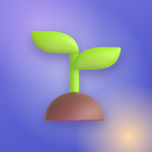

# Habie

**A habit tracker you grow like a garden. Built for the iPad, installed from the browser, no app store in between.**

Every habit is a plant. Log a glass of water, ten minutes of reading or a workout and its ring fills, the garden in the
middle blooms, and a little 3D buddy cheers you on. Finish everything and you get a perfect day, confetti, and a streak
that's a little harder to break tomorrow.

-1180%20×%20820%20pt-7372c8?style=flat-square)


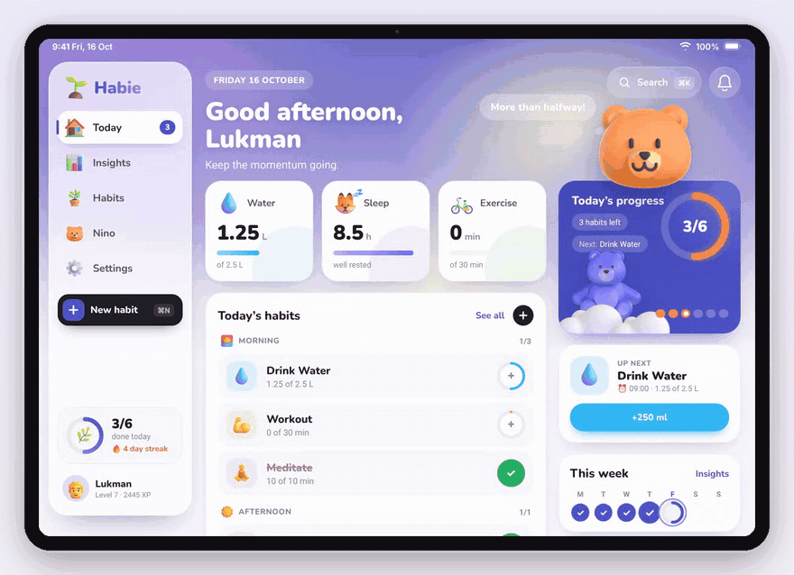

[Screens](#screens) · [How it works](#how-it-fits-together) · [Quickstart](#quickstart) · [Install on iPad](#install-it-on-an-ipad) · [Chat API](#connecting-the-buddy-to-an-api)

</div>

---

## Why this exists

Most habit trackers are spreadsheets with checkboxes. They work for a week, then the streak breaks and the app goes in a
folder. Habie bets on the opposite: make the tracking itself the reward.

- **Visual first.** Water is a tank that fills, a day is a ring of plants, a streak is a flame with a bear in it.
  Numbers are there, but they're never the first thing you see.
- **One device, done properly.** It's designed for exactly one screen: the iPad (A16, 11th generation) in landscape,
  1180 × 820 points. A sidebar, split views and a form sheet, the way an iPad app should feel.
- **Nothing to install from a store.** It's a Progressive Web App. Open the link in Safari, add it to the Home Screen,
  and it launches full screen with its own icon, splash screen and offline support.

## Screens

| | |
|---|---|
| 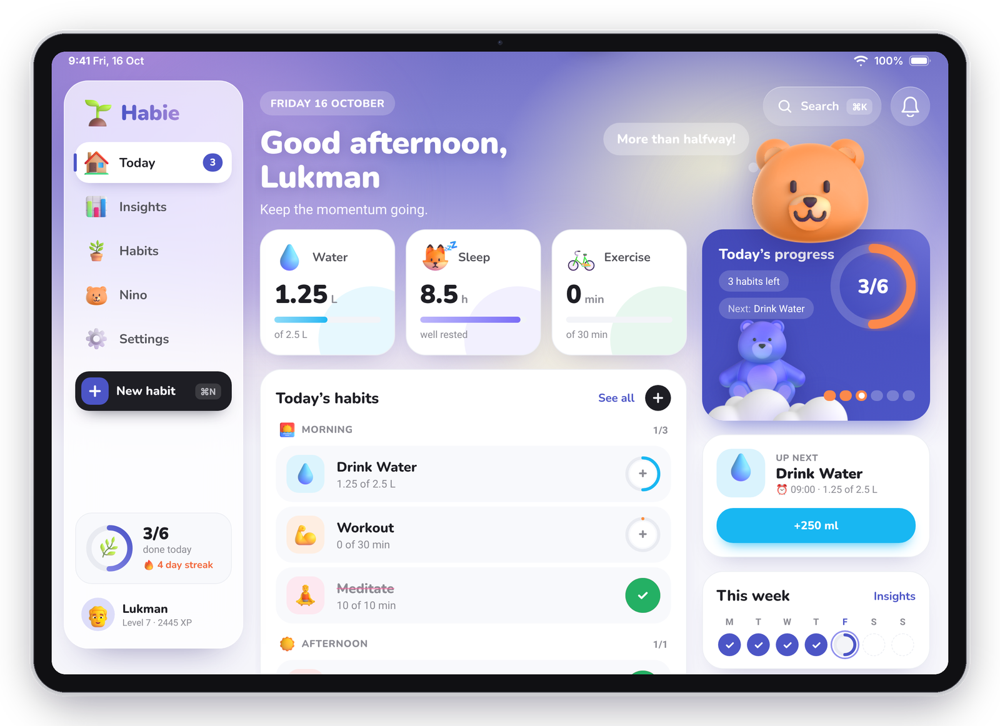 | 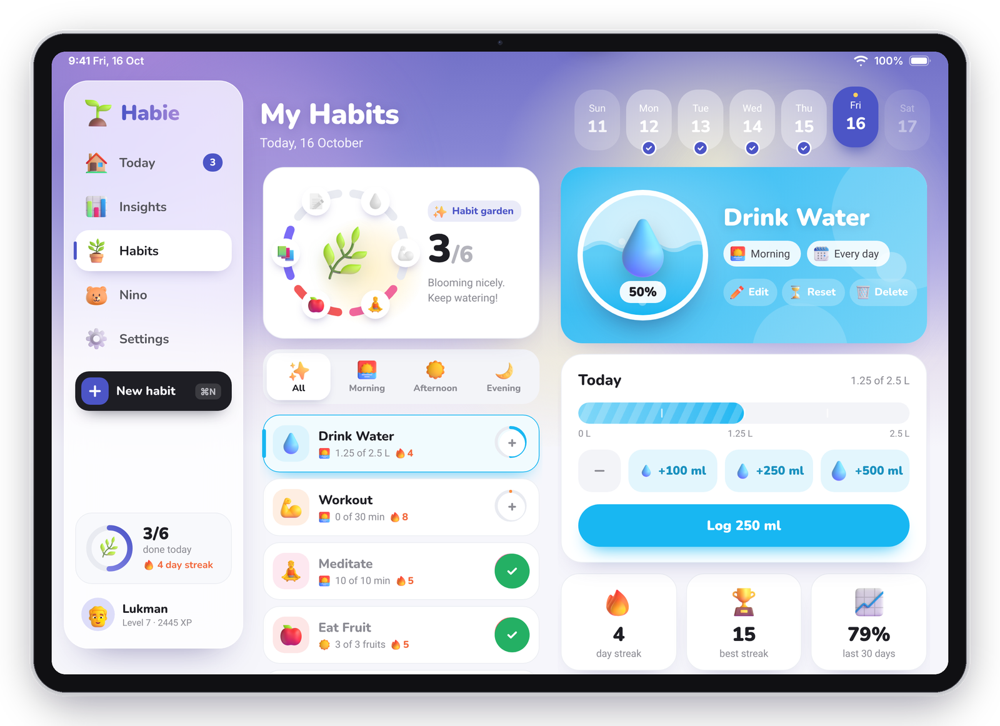 |
| **Today.** A greeting that knows the time of day, three stat cards (water in litres, last night's sleep, exercise), habits grouped into morning, afternoon and evening, and a progress ring in the corner. Every round button adds one step; the ring around it fills as you go. | **Habits.** The list on the left, the habit on the right, like Mail or Notes. The garden ring has one petal per habit and the plant in the middle grows from seedling to sunflower. Water is poured in litres: +100, +250 or +500 ml, and you can watch the tank fill. |
| 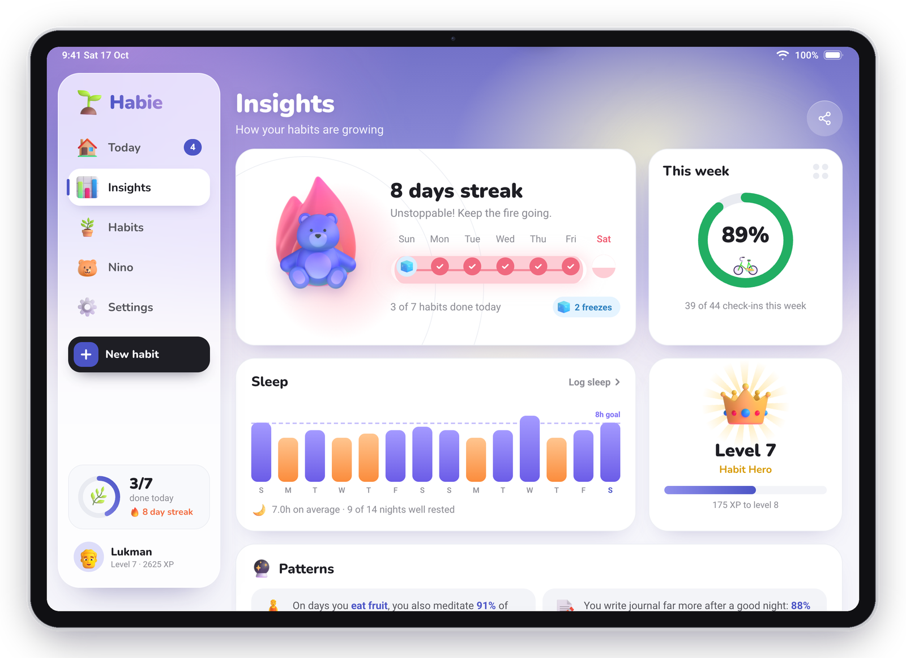 | 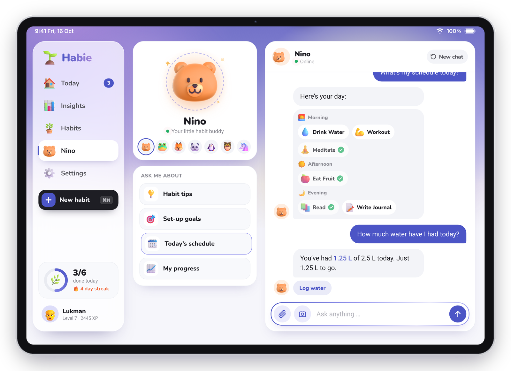 |
| **Insights.** The streak with this week's track, the week's score, fourteen nights of sleep against an 8-hour line, your level, a 14-day grid of every habit and a month calendar where perfect days get a sunflower. | **Buddy.** Seven 3D buddies to choose from. Ask for tips, today's schedule or how you're doing; answers link straight back to the habits. It runs offline today and is ready for a real model ([see below](#connecting-the-buddy-to-an-api)). |
| 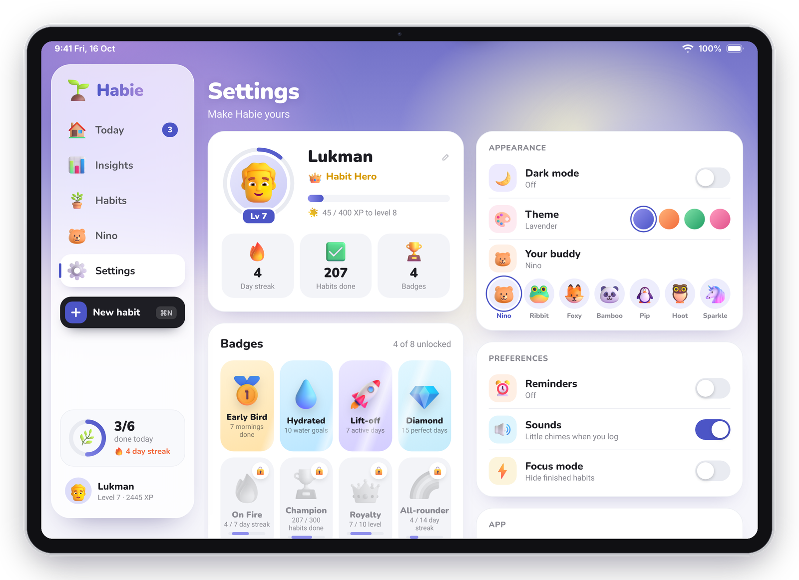 | 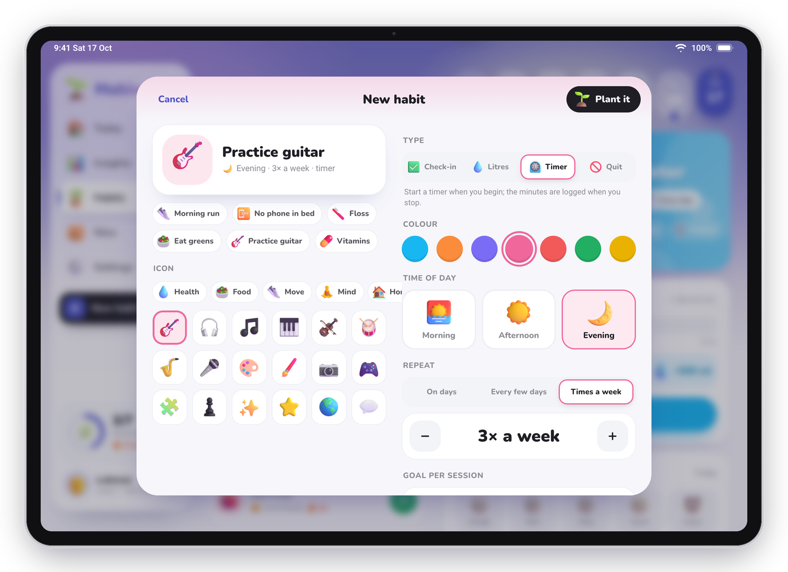 |
| **Settings.** Your level and XP ring, eight badges that unlock from what you actually log, dark mode, four colour themes, reminders, sounds, focus mode, and your data. | **New habit.** An iPadOS form sheet. Pick an idea or start blank, choose an icon, colour, time of day, the days it repeats and how many times a day. The preview at the top updates as you go. |
| 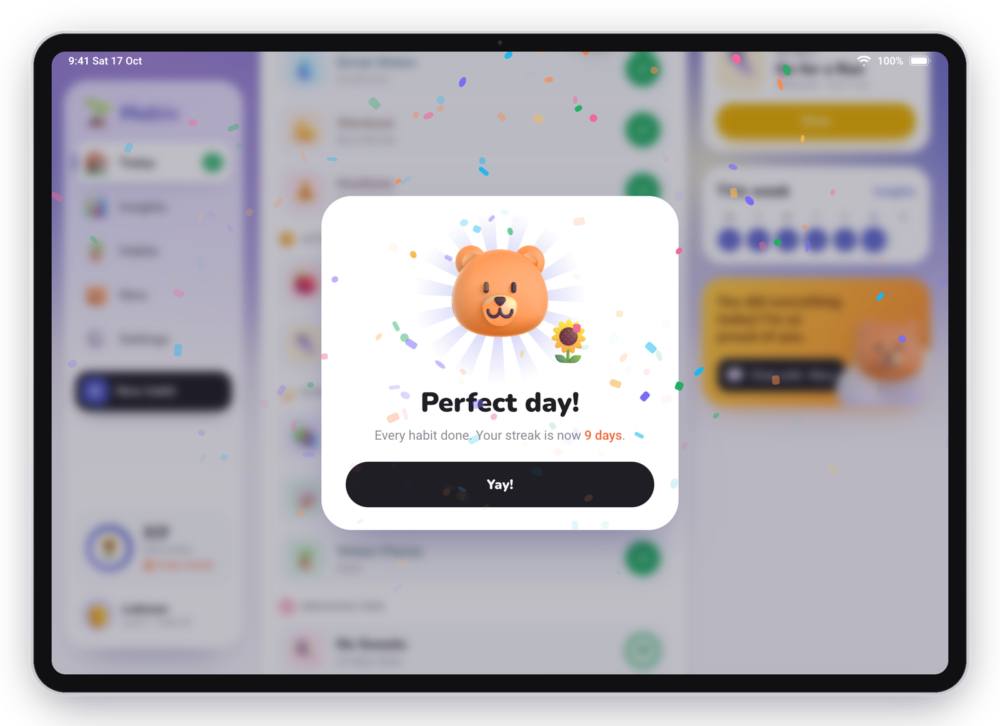 | 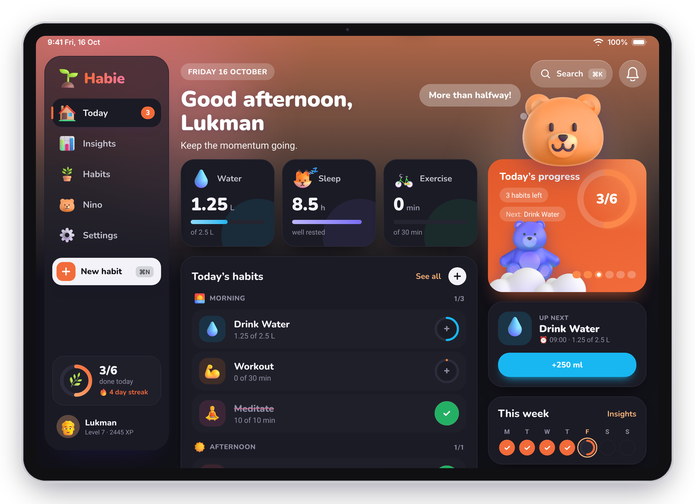 |
| **A perfect day.** Finish every habit and your buddy jumps for joy under a burst of confetti. Level-ups and new badges queue up behind it, so no celebration hides another. | **Dark mode, Peach theme.** Every colour comes from a token, so dark mode and the four themes reach every corner, including the status bar tint. |

<div align="center">
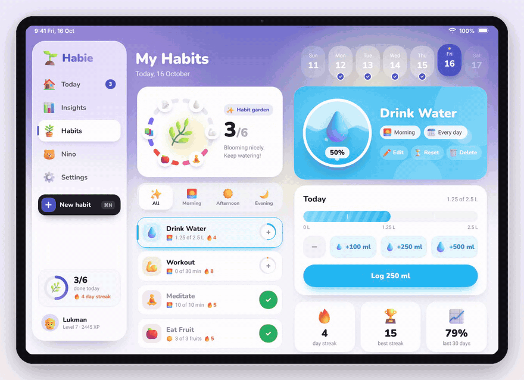
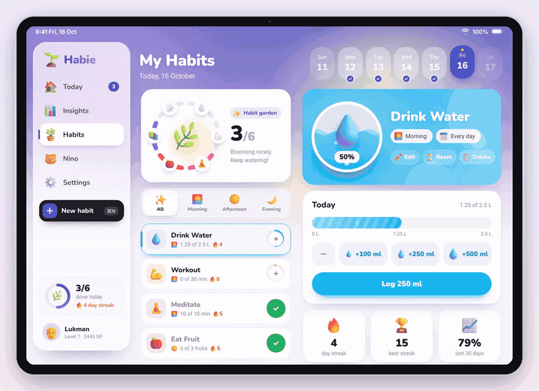
<br />
<b>Pouring water, and planting a new habit.</b> Both recordings are the real app at the iPad's resolution, not mock-ups.
<br /><br />
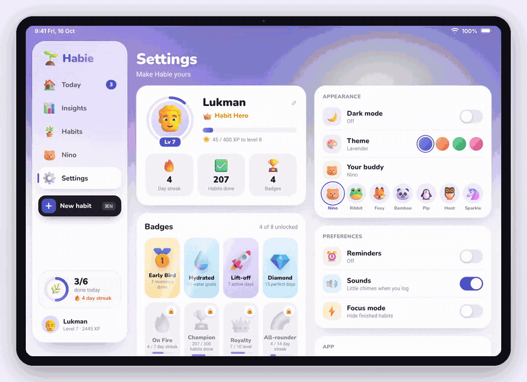
<br />
<b>Dark mode, four themes and seven buddies.</b> Theme changes spread out from your finger with the View Transitions API.
</div>

## How it fits together

```
  ┌──────────────────────────────────────────────────────────────┐
  │  index.html · styles.css   one 1180 × 820 artboard: sidebar, │  static files, no framework,
  │                            five sections, sheets, popovers   │  no build step
  └──────────────────────────────▲───────────────────────────────┘
  ┌──────────────────────────────┴───────────────────────────────┐
  │  js/app.js   renders every section from state, routes by     │  hash routes: #home #insights
  │              #hash, runs transitions, keys and gestures      │  #habits/<id> #buddy #settings #new
  └──────▲───────────────▲──────────────────▲──────────────▲─────┘
  ┌──────┴──────┐ ┌──────┴───────┐ ┌────────┴───────┐ ┌────┴─────────┐
  │ js/store.js │ │  js/fx.js    │ │  js/chat.js    │ │  js/pwa.js   │
  │ state, log, │ │ confetti,    │ │ buddy replies: │ │ service      │
  │ streaks,    │ │ toasts,      │ │ your API if    │ │ worker,      │
  │ XP, badges  │ │ sounds,      │ │ config.js has  │ │ install      │
  │             │ │ count-ups    │ │ one, else      │ │ prompt and   │
  │             │ │              │ │ offline rules  │ │ instructions │
  └──────▲──────┘ └──────────────┘ └────────────────┘ └────▲─────────┘
  ┌──────┴──────────────┐                              ┌───┴──────────┐
  │ localStorage        │                              │ sw.js        │
  │ habie.v3            │                              │ precaches    │
  │ everything you log  │                              │ the app      │
  └─────────────────────┘                              └──────────────┘
```

**Design principles**

- **Designed for one screen.** The artboard is the iPad's landscape viewport, 1180 × 820 points at 2×. The width
  is fixed; the height follows the window, so it fits both Safari (with its toolbars) and the full-screen PWA. Hold
  the iPad upright and Habie asks you to turn it.
- **Visuals before text.** A habit is an icon, a colour and a ring. Progress is a fill, never just a number. Every
  section leads with a picture: the garden, the tank, the flame, the crown.
- **Motion that explains.** Sections slide in the direction you travelled, cards arrive one after another, a logged
  step pops the exact unit you tapped, rings and bars grow to their value, and celebrations queue instead of
  stacking. Everything honours *Reduce Motion*.
- **Everything is derived from the log.** The only thing stored is what you did on which day. Streaks, XP, levels,
  badges, the garden and every chart are computed from that log, so they can never disagree.
- **Your data stays on the iPad.** No account, no server. Export it as JSON or start fresh from Settings.

## Highlights

- **Water in litres.** A gauge with quarter marks, +100 / +250 / +500 ml buttons, a minus for mistakes, and a droplet
  that falls into the tank each time you pour.
- **Log anything in steps.** Pages read in fives, minutes in tens, fruit one at a time. Tap a unit to fill up to it,
  tap the last one again to take it back.
- **Fix yesterday.** The week strip on *Habits* opens any past day of this week; logs and the garden follow.
- **Celebrations that mean something.** Confetti from the button you pressed, a *Perfect day* card when everything is
  done, a level-up card when your XP crosses 400, and a toast for every badge unlocked.
- **Reminders.** Set a time per habit; Habie nudges you with a notification while it's open, and the bell shows
  what's overdue.
- **Keyboard ready.** With a Magic Keyboard: <kbd>⌘</kbd><kbd>K</kbd> search, <kbd>⌘</kbd><kbd>N</kbd> new habit,
  <kbd>⌘</kbd><kbd>1</kbd>–<kbd>5</kbd> sections, <kbd>Esc</kbd> to close. Search also creates a habit from whatever
  you typed.
- **Offline from the first launch.** The service worker precaches every file, fonts included; the app opens on a
  plane.
- **Synthesised sounds.** Little chimes are generated with Web Audio; the app ships no audio files.

## Quickstart

Any static file server works. From the repository root:

```bash
python3 -m http.server 8000
```

Open http://localhost:8000. The first launch seeds six weeks of believable history so every chart has something to
show; **Settings → Your data → Start fresh** clears it.

**Things to try**

1. On **Today**, tap the round button on *Workout* three times. The ring fills, then confetti.
2. Finish the rest of the day's habits and wait for the *Perfect day* card.
3. Open **Habits → Drink Water** and pour +500 ml. Watch the droplet fall into the tank.
4. Press <kbd>⌘</kbd><kbd>N</kbd>, pick *Practice guitar*, and plant it.
5. In **Settings**, flip dark mode and try the four themes and the seven buddies.

## Install it on an iPad

A PWA needs HTTPS to install (localhost is the only exception). Host the folder anywhere static: GitHub Pages,
Netlify, Cloudflare Pages, or any web server.

1. Open the site in **Safari** on the iPad.
2. Tap **Share**, then **Add to Home Screen**.
3. Launch **Habie** from the Home Screen. It opens full screen, landscape, with its own splash screen.

Habie offers this itself: after a few seconds a banner slides in, and **Install Habie** sits in the sidebar until it's
installed. In Chrome or Edge the same button triggers the browser's own install prompt.

## Connecting the buddy to an API

The buddy answers offline today with a small rule-based responder. To use a real model, set an endpoint in
[`config.js`](config.js):

```js
export const CONFIG = {
  chatEndpoint: 'https://example.com/api/habie-chat',
  chatHeaders: { authorization: 'Bearer …' },
};
```

Each message is sent as:

```json
{
  "message": "How am I doing?",
  "image": null,
  "history": [{ "role": "user", "content": "…" }, { "role": "assistant", "content": "…" }],
  "context": {
    "name": "Lukman", "buddy": "Nino", "date": "2026-10-16", "streak": 4,
    "today": [{ "id": "water", "name": "Drink Water", "time": "morning", "value": 1.25, "goal": 2.5, "unit": "L", "done": false }],
    "sleepLastNight": 8.5
  }
}
```

and should return `{ "reply": "text", "actions": [{ "label": "Log water", "href": "#habits/water" }] }`. `actions` are
optional buttons under the reply. If the request fails, the buddy falls back to its offline answers.

## Layout

```
index.html  styles.css      the artboard: 1180 × 820, scaled to the window
config.js                   the chat endpoint
js/app.js                   sections, routing, transitions, keyboard, gestures
js/store.js                 state, dates, streaks, XP, badges, the demo seed
js/fx.js  js/chat.js        effects, the buddy
js/pwa.js  sw.js            install flow, offline cache
manifest.webmanifest        name, icons, shortcuts, screenshots
assets/3d/                  Fluent Emoji 3D artwork (MIT)
assets/fonts/               Nunito and Roboto, self-hosted
assets/icons/  splash/      app icons and iPad launch screens
tools/                      asset, precache and mock-up scripts
docs/images/                the pictures in this README
```

**Dev hooks**, as query strings: `?reset` a fresh demo garden · `?mockup` draw the iPadOS status bar and hide the
install prompts · `?nosplash` skip the launch animation.

**Regenerating things**

| | |
|---|---|
| `python3 tools/precache.py` | refresh the offline file list in `sw.js` after adding or removing files |
| `node tools/build-assets.js` | redraw the app icons and iPad launch screens from `tools/brand.html` |
| `node tools/mockups.js <dir>` then `python3 tools/frame.py <dir>` | recapture the README screenshots and GIFs (needs Playwright, ffmpeg and the app served on :8765) |

## What this is not, yet

- **The buddy isn't a real model.** It answers from rules until an endpoint goes in `config.js`.
- **Reminders only fire while Habie is open.** Background notifications on iPadOS need Web Push, which needs a server.
- **One iPad, one garden.** Data lives in this browser's storage. There's no sync between devices; export is a JSON file.
- **Landscape only.** Portrait shows a "turn your iPad" screen; other screen sizes are scaled, not redesigned.
- **The six weeks of history are seeded**, generated from a fixed seed so the demo is the same every time.

## Credits

Artwork is [Microsoft Fluent Emoji](https://github.com/microsoft/fluentui-emoji) (MIT, see
[`assets/3d/LICENSE`](assets/3d/LICENSE)); some are recoloured to fit the palette. Type is
[Nunito](https://fonts.google.com/specimen/Nunito) and [Roboto](https://fonts.google.com/specimen/Roboto).
The original visual direction comes from the mock-ups in [`reference/`](reference/).
